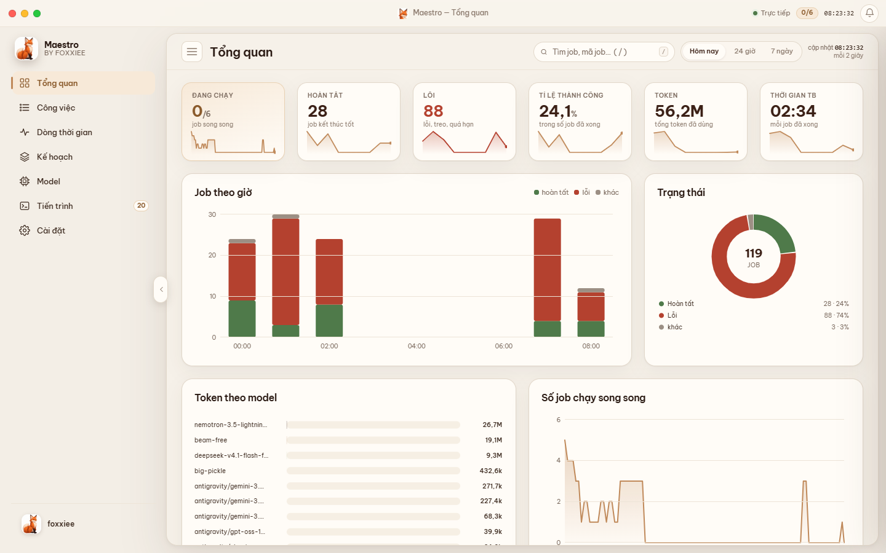
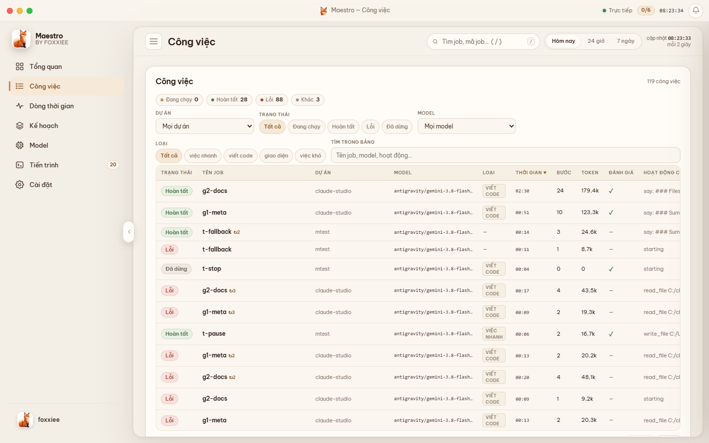
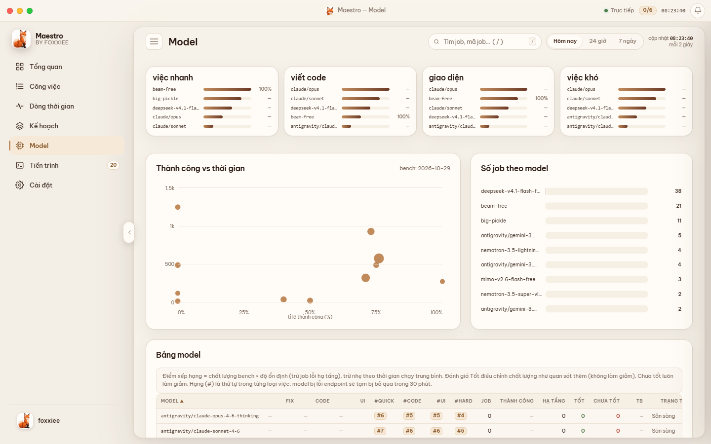
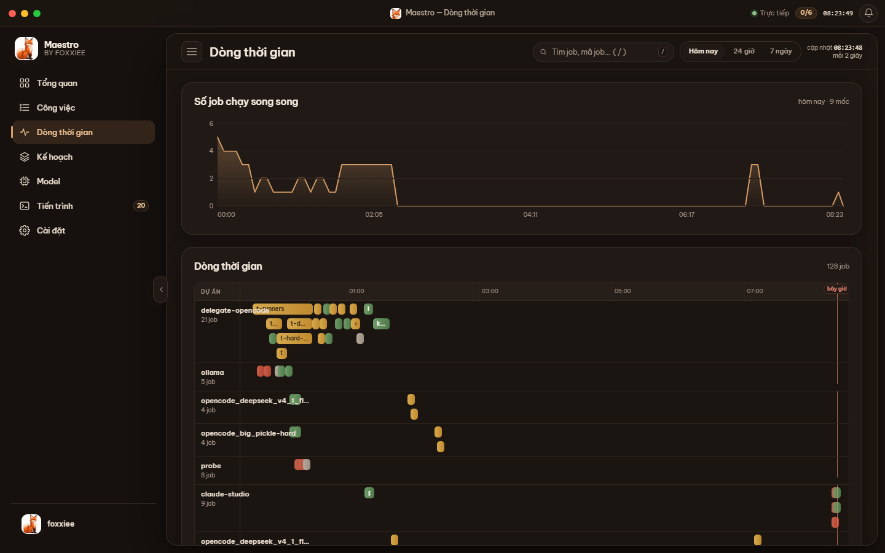
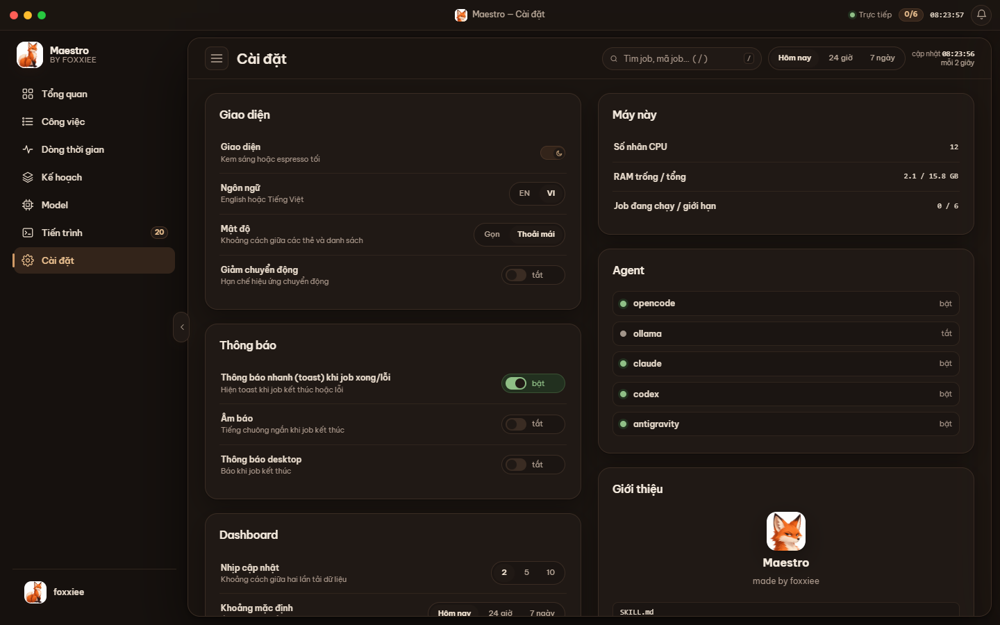

# claude-studio · Maestro

Two Claude Code plugins by **foxxiee**:

| Plugin | What it does |
|---|---|
| **maestro** | An orchestra conductor for coding agents. Claude plans and verifies; agents implement: opencode (free cloud models), the Antigravity CLI (Gemini), Ollama (local), Claude CLI and Codex. Each job goes to a model that fits its difficulty, jobs run in parallel with automatic fallbacks, and a desktop-style dashboard shows everything live. |
| **web-studio** | `/web-studio:design-web` crawls real templates from curated sites into a gallery you pick from, turns your picks into 3 design directions with live motion previews, then builds the site (Next.js + shadcn/ui + motion) through Maestro and checks it in the browser. |



[Tiếng Việt bên dưới](#tiếng-việt)

## Install

```bash
claude plugin marketplace add foxxiee04/claude-studio-maestro
claude plugin install maestro@claude-studio
claude plugin install web-studio@claude-studio
```

Then run each plugin's setup once (or ask Claude: "set up maestro and web-studio"):

```bash
node ~/.claude/plugins/cache/claude-studio/maestro/*/scripts/setup.mjs
node ~/.claude/plugins/cache/claude-studio/web-studio/*/scripts/setup.mjs
```

The Maestro setup creates the `maestro` and `oc` commands, a data folder (`~/.claude-studio/maestro`) and checks
which agents this machine has.

### Requirements

- Node.js 20+
- At least one coding agent: [opencode](https://opencode.ai) (free cloud models), the Antigravity CLI (`agy`, ships
  with Google Antigravity), [Ollama](https://ollama.com), Claude CLI or Codex CLI
- web-studio: pnpm, bash, Microsoft Edge or Google Chrome (template crawler)
- Recommended companion skills: `motion` (`npx motion-ai`), GSAP skills, `frontend-design`, `shadcn`

## Maestro

```bash
maestro                    # open the dashboard app; its server runs hidden in the background
maestro close              # stop the dashboard (also: maestro status, maestro restart)
maestro run brief.md --kind code      # one job; kinds: quick, code, ui, hard
maestro batch plan.json    # a plan of dependent jobs, run in parallel waves
maestro pick --kind hard   # which models a job of that kind would use, and why
maestro models             # every model, its runner, tier, capability level and ranking per kind
maestro limits             # how many jobs may run now (cores, free RAM, CPU, per-model caps)
maestro doctor             # which agents, models and services this machine has
maestro rate <job> good|bad          # your verdict feeds the ranking
```

### Agents

| Runner | Models | Tier |
|---|---|---|
| opencode | free cloud models (deepseek, glm, mimo, nemotron, big-pickle, ...) | free (shared daily quota) |
| antigravity (`agy`) | Gemini 3.8 Flash high/medium/low | free |
| antigravity (`agy`) | Claude Sonnet/Opus 4.6, GPT-OSS 120B | opt-in (`--paid`), small quota |
| ollama | local models | free, one job at a time |
| claude | Claude CLI (haiku, sonnet, opus) | opt-in (`--paid`), uses your plan |
| codex | Codex CLI models | opt-in (`--paid`), quota-guarded |

### How a model is chosen

- **Quality**: public benchmark results (SWE-bench Verified/Pro, DeepSWE, Terminal-Bench) stored as research priors,
  blended with Maestro's own hidden-test bench (fix, code, ui, hard tasks) when available.
- **Reliability**: from real jobs; providers that fail are skipped for a while. When OpenCode's free quota runs out,
  every opencode model is skipped for 3 hours and work moves to the next runner.
- **Your ratings**: `maestro rate` updates the estimate.
- **Difficulty**: capability levels 1-5; `hard` jobs need level 4+, `code` and `ui` 3+, `quick` 2+.
- **Machine**: concurrency follows CPU cores, free RAM and CPU load, with per-model and local-model caps.

### Dashboard

| | |
|---|---|
|  |  |
|  |  |

Pages: overview, jobs (live logs, fallback chain, files touched), timeline, plans, models, processes, settings.
Pause, resume, stop and rate jobs from the UI; notification center; light/dark; English/Vietnamese.

### Safety

Agents edit only inside the project folder (outside paths are denied), never publish version-control history, and the
dashboard listens on 127.0.0.1 only. Every job's result is meant to be verified by Claude before it is called done.
See [SECURITY.md](SECURITY.md).

## Docs

- [Architecture](docs/ARCHITECTURE.md)
- [Project report](docs/REPORT.md)
- [Changelog](CHANGELOG.md) · [Contributing](CONTRIBUTING.md)

## Data and privacy

Job logs, ratings and the template catalog stay on your machine (`~/.claude-studio/`, OS temp folder for job folders).
Nothing is uploaded. The template catalog is crawled locally from public pages; this repository does not redistribute
third-party previews.

## License

MIT · made by **foxxiee**

---

## Tiếng Việt

**claude-studio** gồm hai plugin cho Claude Code, do **foxxiee** làm:

- **maestro**: nhạc trưởng điều phối các agent viết code. Claude lên kế hoạch và kiểm tra; agent thực hiện (opencode
  miễn phí, Antigravity CLI với Gemini, Ollama chạy trên máy, Claude CLI, Codex). Tự chọn model theo độ khó, chạy song
  song có dự phòng, xếp hạng model bằng số liệu benchmark công khai cộng test ẩn, và có dashboard kiểu ứng dụng desktop.
- **web-studio**: `/web-studio:design-web` quét template thật thành gallery để chọn, biến lựa chọn thành 3 hướng thiết
  kế có motion chạy thử, rồi dựng site qua Maestro và kiểm tra trên trình duyệt.

### Cài đặt

```bash
claude plugin marketplace add foxxiee04/claude-studio-maestro
claude plugin install maestro@claude-studio
claude plugin install web-studio@claude-studio
```

Sau đó nhờ Claude "cài đặt maestro và web-studio" (hoặc chạy `scripts/setup.mjs` của từng plugin).

### Dùng nhanh

- `maestro`: mở app dashboard (server chạy ngầm, không có cửa sổ terminal); `maestro close` để tắt
- `maestro pick --kind hard`: xem model nào sẽ nhận việc khó và vì sao
- `maestro limits`, `maestro doctor`: giới hạn theo máy, kiểm tra agent
- `/web-studio:design-web làm landing page cho ...`: làm web từ chọn mẫu đến chạy được

Dữ liệu (log job, đánh giá, catalog template) nằm trên máy bạn, không gửi đi đâu.
