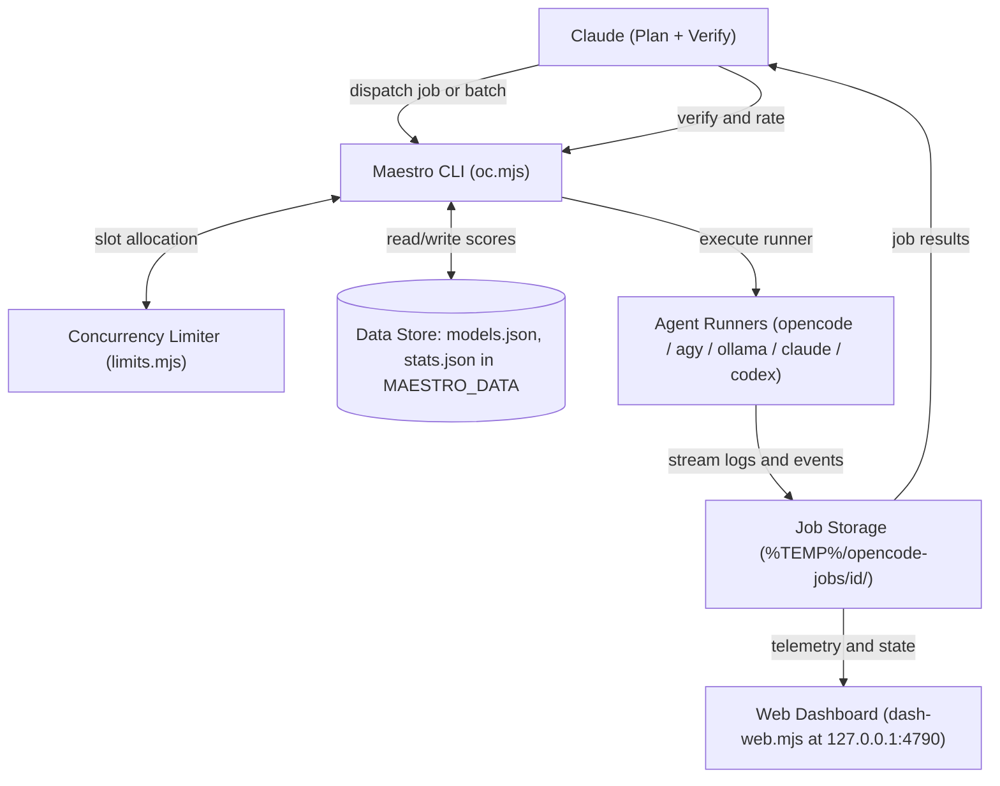

# Maestro Architecture

Maestro orchestrates autonomous coding agents under Claude Code. Claude plans and verifies implementations, while external agent runners write code. Jobs are routed according to difficulty, run concurrently under system resource guards, and ranked through blended benchmarks and Bayesian ratings.

## System Overview

## Job Lifecycle

1. **Brief Definition**: Claude generates a self-contained markdown brief detailing objectives, target files, and acceptance commands. Fixed controller rules (workspace boundary, relative paths, no version-control operations, scratch directory `.oc-tmp/<id>/`) are appended automatically.
2. **Slot Reservation (`reserveJob`, `limits.mjs`)**: Evaluates host resources (CPU <= 85%, RAM free >= 1500 MB), concurrency caps (`OC_MAX_PARALLEL`, `OC_MAX_PER_MODEL` = 2, `OC_MAX_LOCAL` = 1), and ensures no target path/scope overlap with concurrently executing jobs.
3. **Chain Resolution (`pickChain`)**: Selects the primary model and fallback candidates matching job kind, minimum capability level, tier permissions, and dead-model status. Applies load spreading across near-equal scores (`OC_SPREAD`) and exploration for untested models (`OC_EXPLORE`).
4. **Execution Attempt (`runAttempt`)**: Initializes the isolated job directory, closes stdin to avoid blocking, and spawns the runner subprocess (`RUNNERS`).
5. **Event Processing (`onLine`)**: Standard streams and JSON events are logged to `events.jsonl` and `job.log`. Modifying tools (`write`, `edit`, `patch`) record touched files and flag out-of-scope modifications.
6. **Execution Guards**:
   - **Stall Watchdog**: Terminates processes inactive for `--stall` seconds (default 300s) or with 0 steps after 150s.
   - **Silent Done**: Detects attempts that exit with code 0 without modifying files and return empty or raw tool calls.
   - **Quota Guard**: Intercepts provider exhaustion patterns (e.g. OpenCode free-tier limits) to abort immediately and initiate cooldown.
   - **Timeout Watchdog**: Enforces `--timeout` (default 900s), freezing clock calculations during pauses.
7. **Fallback Recovery (`runJob`)**: If an attempt fails due to infrastructure before files are touched, the engine automatically attempts the next model in the resolved chain.
8. **Independent Verification**: Claude inspects working-tree changes using read-only VCS status and diffs, and runs acceptance tests independently.
9. **Bayesian Rating (`rateJob`)**: Verified jobs receive a `good` or `bad` rating, feeding real-world accuracy updates back into model ranking.

## Model Ranking & Selection

- **Quality Score**: Computed by blending hidden-test benchmark results with public research priors:
  `quality = bench` or `(bench + research) / 2` when `models[id].research.quality` exists (e.g. SWE-bench Verified). Hidden-test tasks in `bench.mjs` evaluate `fix` (bug repair), `code` (spec implementation), `ui` (React/motion components), and `hard` (complex integration).
- **Reliability Metric**: Measured from real-world execution history:
  `reliability = 1 - (0.7 * infra_failures) / total_jobs`.
- **Bayesian Rating Updates**: Claude ratings update the prior quality as pseudo-observations with prior weight 2:
  `feedback = (good + 2 * prior) / (good + bad + 2)`. Speed penalties are deducted (`secs / 2000` for `quick`, `secs / 20000` for other kinds).
- **Capability Levels**:
  - `hard` (level >= 4): Filtered by minimum level; ordered by level descending first, then by score.
  - `code` / `ui` (level >= 3): Filtered by minimum level; ordered by score.
  - `quick` (level >= 2): Filtered by minimum level; ordered by score.
  - *Level mapping*: Level 5 (Claude Opus/Sonnet, Antigravity Pro), Level 4 (Codex/GPT-6, DeepSeek-v4.1, GLM-5.3, Antigravity Flash), Level 3 (Claude Haiku, Mimo-v2.6, general cloud), Level 2 (Flash-Lite, Ollama).
- **Tiers & Quotas**:
  - **Free Tier**: OpenCode free models, local Ollama models, Antigravity Gemini models.
  - **Paid / Opt-in Tier**: Claude CLI, Codex CLI, Antigravity Claude/GPT-OSS models; requires `--paid`, batch `paid: true`, or `OC_URGENT=1`. Paid models serve as fallbacks only after free options unless explicitly requested.
  - Rolling quota checks enforce rate limits (Codex: 8 jobs/5h, Claude: 6 jobs/5h).
- **Dead-Model Cooling**: Models with endpoint/infrastructure failures are skipped for 30 minutes (`DEAD_MS = 30m`). Exhaustion of shared OpenCode free quota triggers a 3-hour cooldown across all `opencode/*` free models.

## Files and Data Locations

| Path / Location | Purpose |
|---|---|
| `plugins/maestro/skills/maestro/oc.mjs` | Core CLI controller, job runner, fallback coordinator, and ranking engine |
| `plugins/maestro/skills/maestro/limits.mjs` | Adaptive concurrency limiter (CPU, RAM, per-model, and local capacity) |
| `plugins/maestro/skills/maestro/bench.mjs` | Hidden-test benchmark harness (`fix`, `code`, `ui`, `hard` tasks) |
| `plugins/maestro/skills/maestro/dash-web.mjs` | Standalone browser dashboard server (bound to `127.0.0.1:4790`) |
| `MAESTRO_DATA/models.json` | Model registry, hidden benchmark scores, and public research priors |
| `MAESTRO_DATA/stats.json` | Execution telemetry, infrastructure failure logs, and Bayesian rating records |
| `%TEMP%/opencode-jobs/<id>/` | Execution workspace: `job.json`, `brief.md`, `job.log`, `events.jsonl`, `debug.log` |
| `<project>/.oc-tmp/<id>/` | Sandboxed per-job scratchpad directory, removed upon run completion |
